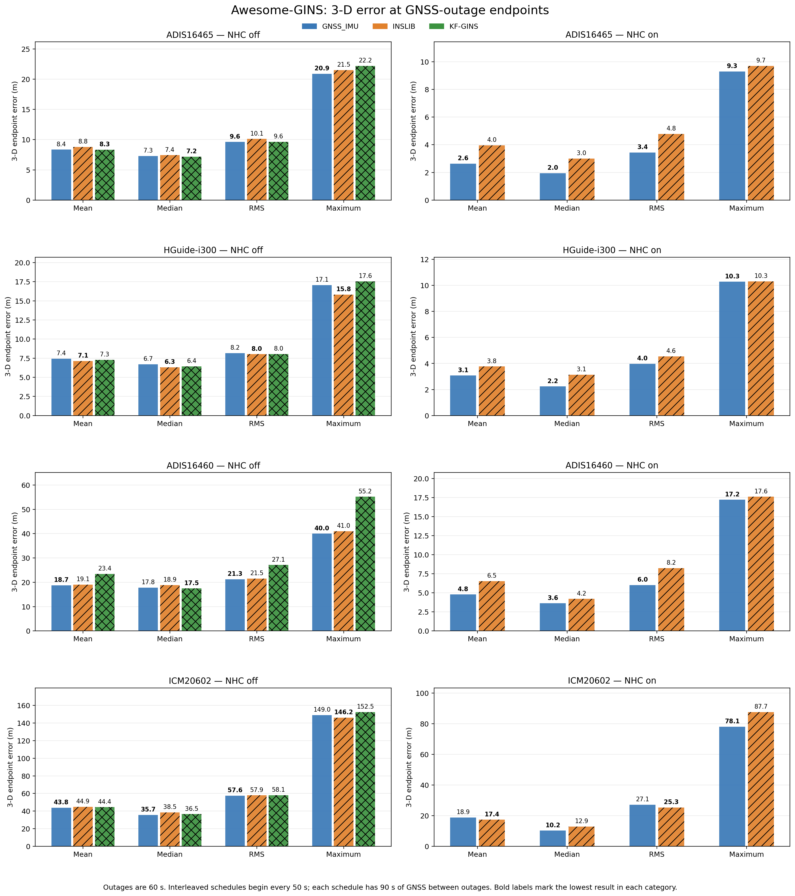
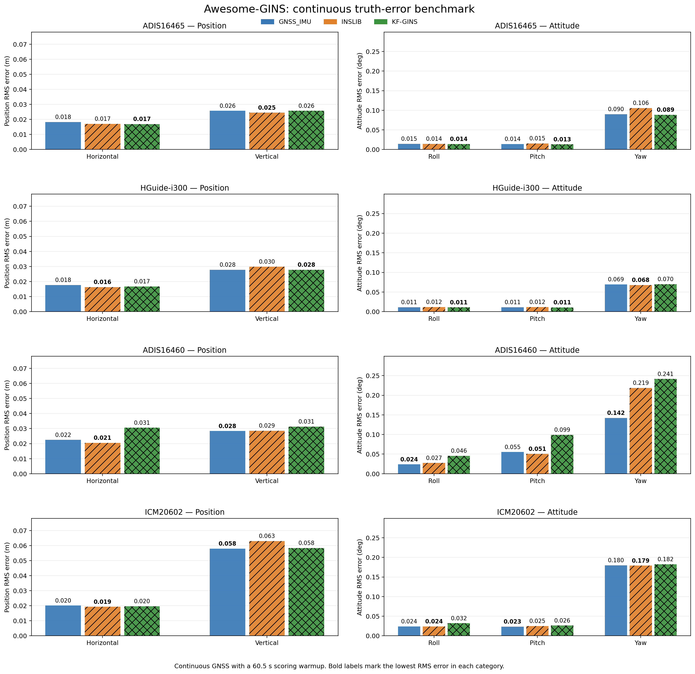

# GNSS_IMU

Python implementation of loosely coupled GNSS/IMU sensor fusion based on the MATLAB code and textbook by Paul Groves, *Principles of GNSS, Inertial, and Multisensor Integrated Navigation Systems*. The code is written in Python to make it easy to experiment with the navigation algorithms, change filter settings, and modify or extend the implementation.

GNSS_IMU is available under the permissive [BSD 3-Clause license](LICENSE), allowing private, academic, and commercial use, modification, and redistribution subject to its notice and non-endorsement conditions.

The only sample data supported by the current scripts is the [Awesome-GINS dataset](https://github.com/i2Nav-WHU/awesome-gins-datasets), with ADIS16465, ADIS16460, ICM20602, and HGuide-i300 IMU recordings, a shared GNSS RTK solution, and reference trajectories. **The sample data is not included in this repository and must be downloaded.** A supplied script downloads and extracts it automatically; another converts it to GNSS_IMU input format.

To download the data and process the default ADIS16465 sample, run these commands from the repository root with Python 3.10 or newer:

```powershell
python -m pip install numpy scipy matplotlib py7zr
python src/get_Awesome_GINS_data.py
python src/convert_KF_GINS_files.py
python src/GNSS_IMU.py
```

`py7zr` is optional if 7-Zip is installed and discoverable. Raw data is saved under `data/awesome_gins`, and converted inputs under `data/awesome_gins/converted`. Download and conversion are needed only when preparing or refreshing the data; `GNSS_IMU.py` itself does not perform them.

To change the default processing options, edit `src/ADIS16465_config.py`. The default configuration includes recurring 60-second simulated GNSS outages, starting at 300 seconds with 240 seconds of GNSS between outages. To process another sensor, select its configuration and input stem together, for example:

```powershell
python src/GNSS_IMU.py --config ICM20602_config.py --file-in ICM20602_sf
```

The other configuration/input pairs are `ADIS16460_config.py` / `ADIS16460_sf` and `i300_config.py` / `i300_sf`. To run with continuous GNSS and no interactive plots, use `python src/GNSS_IMU.py --outage-duration 0 --no-plots`. Use `--help` to see the available overrides.

GNSS input and fused output files use an extended RTKLIB solution format and can be explored with RTKLIB. The default output is `data/awesome_gins/converted/gnss_imu_ADIS16465_sf.pos`; repeating a run overwrites its output. Configuration options include Kalman filter noise parameters, IMU bias and scale-factor estimation, lever arms, simulated outages, initial yaw alignment, velocity matching, zero-velocity updates, non-holonomic constraints, and forward/backward processing. The supplied sample configurations use truth-derived initial attitude.

## Benchmark comparison

The benchmark compares GNSS_IMU with INSLIB and KF-GINS across all four sample IMUs. It evaluates error before GNSS returns from simulated outages, with NHC enabled and disabled where supported, and continuous-GNSS position and attitude errors against the reference trajectory.

To run it, first obtain and build INSLIB, including its Python bindings, replay tools, and per-sensor `datasets/kfgins` configuration files, and build the KF-GINS executable. Install their dependencies according to those projects' instructions. Edit `INSLIB_ROOT`, `KF_GINS_ROOT`, and, if necessary, `KF_EXE` in `src/run_benchmark.py` to match your installations. Then run:

```powershell
python src/run_benchmark.py
```

The runner has no command-line options; edit its parameter block to select experiments, outage timing, parallelism, and which IMUs to rerun. It automatically invokes download and conversion when their respective data directories are absent. For an incomplete existing directory, run the preparation scripts manually. The default benchmark uses 60-second outages separated by 90 seconds of GNSS, and also runs continuous comparisons with a 60.5-second scoring warmup. JSON results, logs, reports, and figures are saved under `benchmark_results`. External estimators are required only for the benchmark, not for running GNSS_IMU on its own.

GNSS outage comparison:



Continuous GNSS comparison:



To calculate NHC pitch/yaw misalignment, run `python src/calibrate_nhc_misalignment.py` using GNSS_IMU as the default navigation source, or add `--estimator INSLIB` to use INSLIB. Both modes run with continuous GNSS and NHC disabled, and output settings for both code sets plus the rotation matrix. Reports are saved separately under `benchmark_results/gnss_imu_nhc_calibration` or `benchmark_results/inslib_nhc_calibration`; production configurations are not modified.

See the [user manual](docs/GNSS_IMU_User_Manual.docx) for sample-data instructions, calibration details, a detailed benchmark walkthrough, and explanations of every sensor configuration option.

An [introduction to the code](https://rtklibexplorer.wordpress.com/2025/09/22/loosely-coupled-sensor-fusion-with-gnss-and-imu-data/) and an [earlier KF-GINS sample analysis](https://rtklibexplorer.wordpress.com/2025/12/14/loosely-coupled-sensor-fusion-part-ii/) provide background; their sample-data instructions predate the current Awesome-GINS workflow.

This code was originally developed as a demonstration tool for a project to improve positioning for underground utility locators in challenging GNSS conditions. Special thanks to Seescan Inc. for allowing the code to be shared as an open-source project. Comments, issues, and pull requests are welcome.

This software is provided **AS IS**, without warranties. Please assess it carefully, especially if using it in a real-time application.
